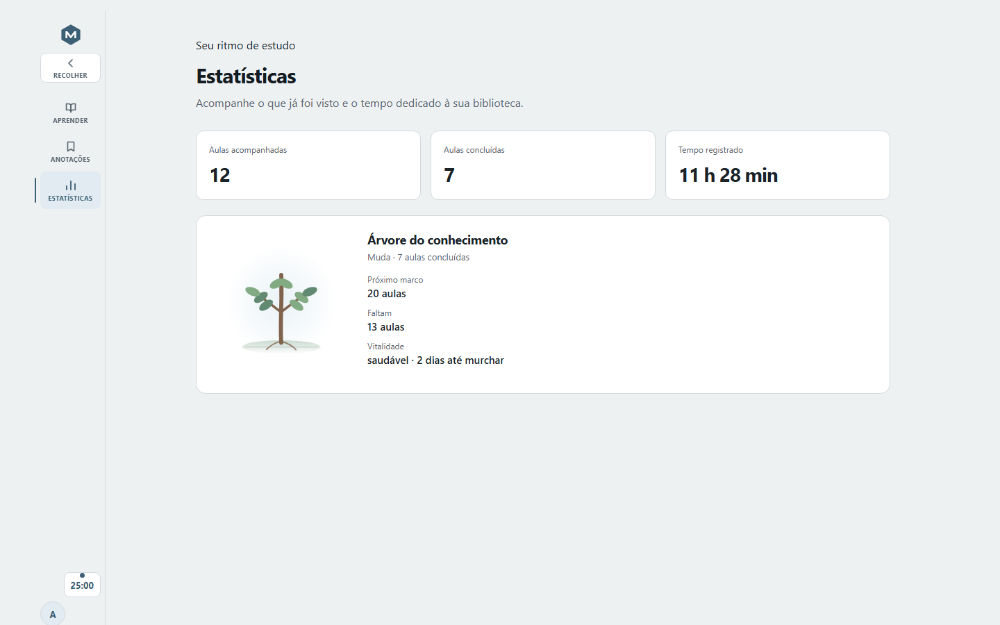

<div align="center">
  
  <h1>LearnVault</h1>
  <p>Seus cursos, organizados em um espaço de estudo que você controla.</p>
  <p>
    <a href="https://github.com/AndersonTavares0/LearnVault/actions/workflows/ci.yml"></a>
    <a href="LICENSE"></a>
  </p>
  <p>
    <a href="https://github.com/AndersonTavares0/LearnVault/releases/latest">Baixar</a> ·
    <a href="#o-que-voc%C3%AA-pode-fazer">Conhecer o app</a> ·
    <a href="#contribuir">Contribuir</a>
  </p>
</div>

> **Fase inicial.** O LearnVault está em desenvolvimento ativo, antes da versão 1.0. Espere mudanças entre versões nas funcionalidades e na organização dos dados; não use como único repositório de materiais que você não pode perder.

## Estude no seu ritmo

O LearnVault organiza cursos que você já tem em pastas. Ele cria um catálogo para encontrar aulas, assistir a vídeos, ouvir áudios e acompanhar seu progresso, sem mover nem alterar os arquivos originais.

Você pode usar o servidor pela Web ou abrir a biblioteca no aplicativo desktop offline.



## O que você pode fazer

- Reunir cursos e materiais locais em um catálogo pesquisável.
- Navegar por módulos e aulas e continuar de onde parou.
- Reproduzir vídeos e áudios ou baixar materiais e legendas.
- Manter os arquivos originais no lugar: o LearnVault lê a pasta do curso, mas não a altera.
- Acompanhar as aulas e o tempo de estudo na Árvore do Conhecimento, que cresce a cada aula concluída.
- Escolher a paleta da interface em Configurações: Blue-slate (padrão), Deep Petrol ou Balanced Sage.

## Escolha como usar

| | Servidor + Web | Desktop offline |
| --- | --- | --- |
| Para quem | Quer acessar pelo navegador ou hospedar na própria rede | Quer estudar localmente, sem conta ou servidor |
| Disponibilidade | Tarballs Linux para x86-64 e ARM64 | Instalador Windows `.exe` |
| Linux desktop | Não há pacote publicado | Flatpak continua em validação |

Baixe os arquivos disponíveis na [página de releases](https://github.com/AndersonTavares0/LearnVault/releases/latest). A distribuição Flatpak e a publicação OCI para instalação self-hosted ainda não estão disponíveis. Consulte o [guia de distribuição](docs/operations/distribution.md) antes de instalar ou atualizar.

## Começar a desenvolver

O LearnVault está em desenvolvimento ativo. Para rodar a versão local, instale Rust 1.99, Node.js 24 e pnpm 11.28.5. Docker é opcional.

```sh
pnpm install --frozen-lockfile
```

Rode esse comando uma vez por checkout. Ele não roda sozinho dentro de `pnpm dev` nem de `pnpm dev:tauri`.

| Comando | O que abre |
| --- | --- |
| `pnpm dev` | Servidor Rust e interface web em `http://localhost:5173` |
| `pnpm dev:tauri` | Aplicativo desktop Tauri |

`pnpm dev` sobe a API em `http://127.0.0.1:8090` e a interface web com recarga automática. Na primeira execução, entre com `admin`/`admin`, importe uma pasta de curso e troque a senha. `pnpm dev:tauri` abre o desktop offline, sem login e sem portas de rede.

Cada worktree cria o próprio `target/` do Cargo. Rode `pnpm worktree:gc` para apagar esse cache nos worktrees vinculados e liberar espaço; use `--dry-run` para ver o total antes.

Antes de enviar uma mudança, rode:

```sh
pnpm verify
```

Para a instalação das ferramentas e o primeiro acesso passo a passo, consulte
[Primeiros passos](docs/wiki/getting-started.md). Veja o [guia de
contribuição](.github/CONTRIBUTING.md) para os checks, convenções de PR, segurança
dos dados e configuração completa.

## Contribuir

1. Procure uma issue ou Discussion existente. Abra uma issue antes de propor mudança de comportamento; use Discussion quando a solução ainda estiver em debate.
2. Faça uma alteração focada e teste o fluxo afetado. Para mudanças de interface, inclua uma captura de tela na pull request.
3. Não envie cursos, credenciais, dados pessoais, bancos locais ou arquivos gerados.
4. Abra uma pull request com o problema, a solução e os testes executados. Aguarde a revisão e os checks obrigatórios.

O projeto usa `pnpm` para dependências do frontend e Conventional Commits para títulos e commits. Consulte [CONTRIBUTING.md](.github/CONTRIBUTING.md) antes de começar.

## Mais informações

- [Guia de início e uso](docs/wiki/getting-started.md)
- [Documentação do projeto](docs/README.md)
- [Arquitetura](docs/architecture/overview.md)
- [Roadmap](docs/product/roadmap.md)
- [Reportar vulnerabilidade](.github/SECURITY.md)
- [Licença MIT](LICENSE)
