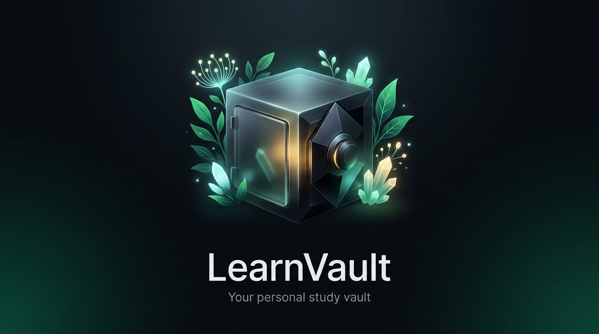
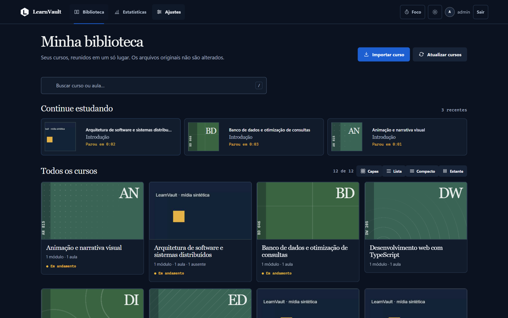
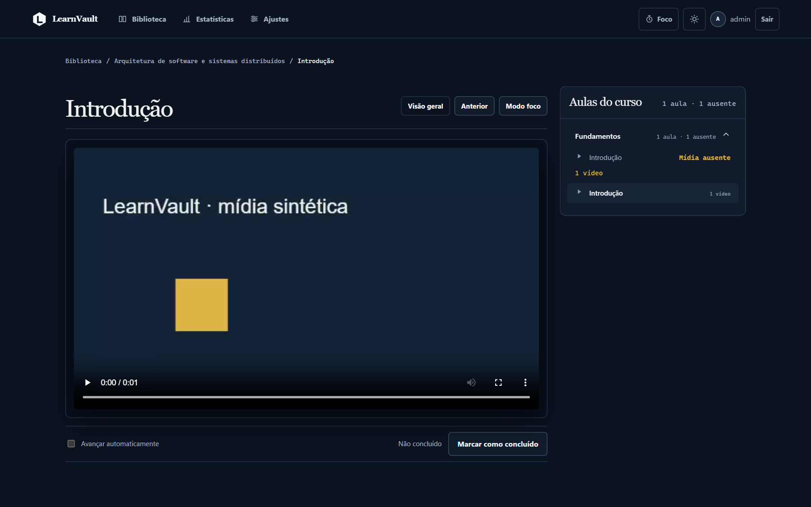
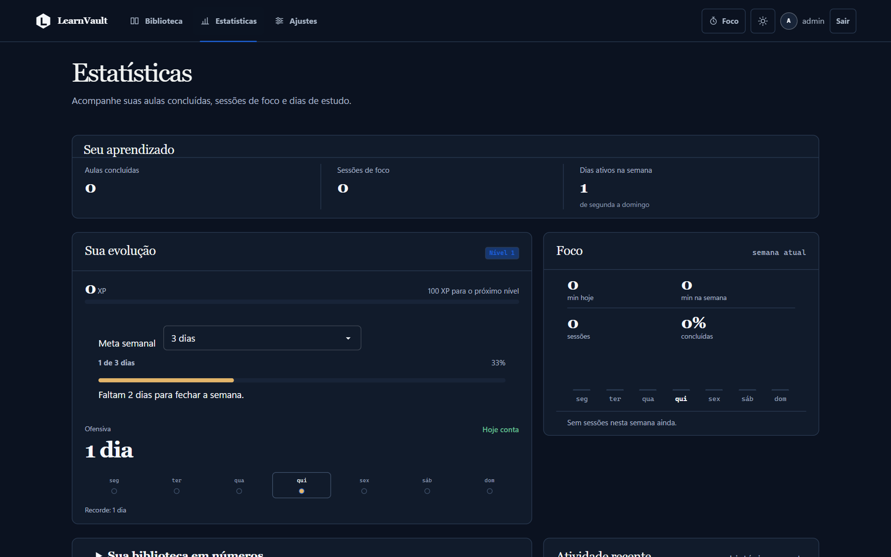

<div align="center">

  

  <br>

  **A privacy-first, self-hosted course library and offline study workspace.**

  Organize the course videos, audios, and materials you already own into a personal study space—without moving, renaming, or modifying a single file.

  [](https://github.com/AndersonTavares0/LearnVault/actions/workflows/ci.yml)
  [](https://github.com/AndersonTavares0/LearnVault/releases)
  [](LICENSE)
  [](https://www.rust-lang.org)
  [](https://svelte.dev)
  [](https://tauri.app)

  [Features](#-key-features) • [Downloads & Deployment](#-downloads--deployment) • [Quickstart](#-quickstart) • [Development](#-development) • [Documentation](docs/README.md)

</div>

---

<div align="center">
  
</div>

---

## 💡 Why LearnVault?

Most course platforms either lock your media into proprietary clouds or force you to browse bare folders in a media player. **LearnVault gives you the best of both worlds:**

- 🛡️ **Zero File Mutation:** Your physical course library is strictly **read-only**. LearnVault never alters, renames, copies, or moves your original files.
- 🚀 **Two Modes, One Unified Engine:**
  - **Self-Hosted Server:** Axum HTTP backend + SQLite with multi-user accounts, secure cookie sessions, and on-demand transcoding for shared home servers or homelabs.
  - **Offline Desktop Application:** Tauri 2 native desktop app with zero open network ports and instant offline access.
- 🌐 **Full Internationalization (i18n):** Native support for **English** (`en`, default) and **Brazilian Portuguese** (`pt-BR`) with instant switching and persistent user preferences.
- 🔒 **Private & Sustainable:** No telemetry, no third-party CDNs, and zero cloud lock-in.

---

## ✨ Key Features

### 📺 Integrated Video & Audio Player
- **Smooth Playback:** Persistent playback speed, keyboard shortcuts (`J`/`K`/`L`, `0-9`, `M`, `N`, `F`, `P`, `[`/`]`), Picture-in-Picture, and automatic next-lesson advance.
- **Timeline Note Markers:** Jump directly to key moments with visual bookmarks on the playback scrubber.
- **Smart Transcoding & Subtitles:** Native VTT subtitles, automatic on-the-fly SRT conversion, and on-demand FFmpeg remuxing for extended formats (`.mkv`, `.avi`, `.wmv`, HEVC, AC3).

<div align="center">
  
</div>

### 📝 Notes & Spaced Repetition Flashcards
- **Timestamped Notes:** Capture notes attached to exact timestamps; clicking any note instantly seeks the video to that moment.
- **Global Search:** Search through lesson titles, course modules, and study notes in real-time.
- **Spaced Repetition (Flashcards):** Review active recall flashcards per lesson with interval calculations powered by the SM-2 algorithm.

### 🌲 2.5D Study Forest & Pomodoro Focus
- **Offline-Resilient Timer:** Integrated Pomodoro timer with offline queue sync and conflict resolution.
- **Habit Streaks & Goals:** Track daily focus minutes, weekly active streaks, and daily completion missions.
- **Isometric Botanical Garden:** Completed focus sessions cultivate trees in your personal 2.5D isometric study forest.

<div align="center">
  
</div>

### 👥 Multi-User Accounts & Access Control
- **Student Profiles:** Individual accounts with isolated progress, personal notes, flashcard decks, and focus stats.
- **Granular Permissions:** Administrators can grant students access to specific courses or the entire catalog.

---

## 📦 Downloads & Deployment

LearnVault provides official release artifacts built directly by automated GitHub Actions CI:

| Platform | Deployment Target | Format | Status | Notes |
| :--- | :--- | :--- | :--- | :--- |
| **Windows** | Desktop App | Installer (`.exe`) | **Available** | Per-user NSIS installer with signed auto-updater |
| **Linux** | Self-Hosted Server | Standalone Tarball (`.tar.gz`) | **Available** | `x86_64` & `aarch64` binaries with embedded SPA |
| **Any OS** | Containerized Server | OCI Container Image | **Available** | Published on GHCR (`ghcr.io/andersontavares0/learnvault`) |
| **Linux** | Desktop App | Flatpak | *In Development* | Desktop Linux Flatpak sandbox packaging is currently on roadmap |

Verify integrity using the `SHA256SUMS` file published with each [GitHub Release](https://github.com/AndersonTavares0/LearnVault/releases).

---

## 🚀 Quickstart

### Option A: Docker Compose (Self-Hosted Server)

Create a `compose.yaml` file:

```yaml
services:
  learnvault:
    image: ghcr.io/andersontavares0/learnvault:latest
    container_name: learnvault
    restart: unless-stopped
    ports:
      - "8090:8090"
    environment:
      - DATA_DIR=/data
      - LISTEN_ADDR=0.0.0.0
      - PORT=8090
      - ADMIN_USERNAME=admin
      - ADMIN_PASSWORD=admin-change-me-promptly
    volumes:
      - ./data:/data
      - /path/to/your/courses:/library:ro
```

Run the container:

```sh
docker compose up -d
```

Open `http://localhost:8090`, log in with your configured admin credentials, and change your temporary password.

---

### Option B: Linux Standalone Server

1. Download the latest `learnvault-linux-amd64.tar.gz` from the [Releases page](https://github.com/AndersonTavares0/LearnVault/releases).
2. Extract the archive and launch the server:

```sh
tar -xzf learnvault-linux-amd64.tar.gz
./learnvault-linux-amd64 --web-root web --library-root /path/to/your/courses
```

---

### Option C: Windows Desktop Application

1. Download `learnvault-windows-vX.Y.Z.exe` from [Releases](https://github.com/AndersonTavares0/LearnVault/releases).
2. Run the installer (installs per-user into `%LOCALAPPDATA%\LearnVault` without requiring admin rights).
3. Select your course library folder via the native dialog and start studying offline.

---

## 🛠️ Development

LearnVault is written in **Rust** (backend/desktop) and **Svelte 5 + TypeScript** (frontend SPA).

### Prerequisites
- **Rust:** 1.89+ (`rustup default stable`)
- **Node.js:** 24+
- **pnpm:** 11.28.5 (specified in `package.json`)

### Setup
```sh
git clone https://github.com/AndersonTavares0/LearnVault.git
cd LearnVault

export PATH="$HOME/.cargo/bin:$PATH"
pnpm install --frozen-lockfile
```

### Common Commands

```sh
pnpm dev                     # Start Rust API server (8090) and Vite SPA (5173) with live reload
pnpm dev:tauri               # Launch Tauri desktop application in development mode
pnpm verify --fast           # Fast verification (Svelte check, Vitest unit tests, Cargo lints/tests)
pnpm exec playwright test    # Run Playwright end-to-end browser tests
pnpm run build               # Build production SPA assets
pnpm run build:desktop       # Build embedded desktop SPA bundle
cargo clippy --all-targets -- -D warnings
cargo test --all
```

---

## 📖 Canonical Documentation

For in-depth guides and architectural design records, consult the canonical documentation:

- [Documentation Guide](docs/README.md)
- [Architecture Overview](docs/architecture/overview.md)
- [API Reference](docs/reference/api.md)
- [Product Requirements](docs/product/requirements.md)
- [Product Roadmap](docs/product/roadmap.md)
- [Distribution & Operations](docs/operations/distribution.md)
- [Architecture Decision Records (ADR)](docs/architecture/adr/README.md)
- [Security Policy](.github/SECURITY.md)

---

## 🤝 Contributing

Contributions are welcome! Please read [`.github/CONTRIBUTING.md`](.github/CONTRIBUTING.md) and [`AGENTS.md`](AGENTS.md) before submitting pull requests.

1. Open an issue for proposed feature changes; use Discussions for design debates.
2. Follow Conventional Commits in English (e.g. `feat(i18n): add language switcher`).
3. Maintain the **read-only course library** invariant at all times.
4. Verify your changes pass `pnpm verify --fast` before submitting.

---

## 📄 License

LearnVault is licensed under the [MIT License](LICENSE).
