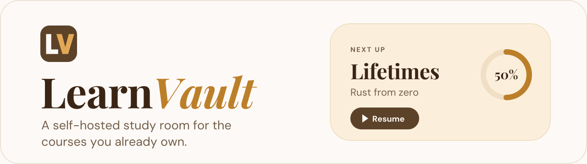

<div align="center">

  

  <br>

  **A privacy-first, self-hosted course library and offline study workspace.**

  Organize the course videos, audios, and materials you already own into a personal study space without moving, renaming, or modifying a single file.

  [](https://github.com/AndersonTavares0/LearnVault/actions/workflows/ci.yml)
  [](https://github.com/AndersonTavares0/LearnVault/releases)
  [](LICENSE)
  [](https://www.rust-lang.org)
  [](https://svelte.dev)
  [](https://tauri.app)

  [Features](#features) • [Downloads &amp; Deployment](#downloads--deployment) • [Quickstart](#quickstart) • [Development](#development) • [Documentation](docs/README.md)

</div>

---

<div align="center">
  
</div>

---

## Overview

LearnVault turns folders of video courses into a structured study environment. Instead of relying on proprietary cloud platforms or bare media player folders, it indexes existing directories on your disk, tracks your progress, links timestamped markdown notes to video moments, and generates spaced repetition flashcards.

### Core Guarantees

- **Zero File Mutation:** The underlying course library is strictly read-only. LearnVault never modifies, renames, copies, or moves your media files.
- **Two Delivery Targets, One Domain Engine:**
  - **Self-Hosted Server:** Axum HTTP backend and SQLite database with multi-user accounts, secure cookie sessions, and on-demand transcoding for home servers or homelabs.
  - **Offline Desktop Application:** Tauri 2 native desktop app with zero open network ports and complete offline capability.
- **Full Internationalization (i18n):** Native runtime support for English (`en`, default) and Brazilian Portuguese (`pt-BR`), with instant locale switching and persistent preferences.
- **Data Sovereignty:** No telemetry, no third-party CDNs, and zero cloud dependencies. All data resides in a local SQLite file.

---

## Features

### Integrated Video and Audio Player

- **Playback Controls:** Persistent speed selection, keyboard shortcuts (`J`/`K`/`L`, `0-9`, `M`, `N`, `F`, `P`, `[`/`]`), Picture-in-Picture, and automatic lesson advance.
- **Timeline Markers:** Visual timeline pins for user notes directly on the scrubber.
- **Format Handling:** Native playback with automated WebVTT conversion for SubRip (`.srt`) subtitles, plus on-demand FFmpeg remuxing for extended containers (`.mkv`, `.avi`, `.wmv`) and audio formats.

<div align="center">
  
</div>

### Timestamped Notes and Spaced Repetition

- **Timestamped Study Notes:** Capture markdown notes anchored to exact video timestamps; clicking a note seeks the player directly to that instant.
- **Catalog-Wide Search:** Query lesson titles, module folders, and study notes in real-time.
- **Flashcard Review (SM-2):** Generate and drill flashcards per lesson with interval calculations driven by the SuperMemo-2 spaced repetition algorithm.

### Study Forest and Focus Timer

- **Offline-Safe Pomodoro:** Built-in focus timer with local queuing and conflict-free state synchronization.
- **Study Analytics:** Track daily focus minutes, completion streaks, and weekly consistency metrics.
- **Botanical Forest Nursery:** Successful study blocks cultivate trees in a personal 2.5D isometric forest garden.

<div align="center">
  
</div>

### Multi-User Accounts and Permissions

- **Isolated Student Profiles:** Individual accounts maintain private progress records, personal notes, flashcard decks, and focus stats.
- **Access Control:** Administrators can restrict or grant access to specific courses or the entire catalog per user.

---

## Downloads & Deployment

Release assets are compiled automatically by GitHub Actions CI:

| Platform | Target | Format | Status | Distribution Notes |
| :--- | :--- | :--- | :--- | :--- |
| **Windows** | Desktop Application | Installer (`.exe`) | **Available** | Per-user NSIS package with signed auto-updater |
| **Linux** | Self-Hosted Server | Standalone Tarball (`.tar.gz`) | **Available** | `x86_64` and `aarch64` binaries with embedded web SPA |
| **Any OS** | Containerized Server | OCI Image | **Available** | Published on GHCR (`ghcr.io/andersontavares0/learnvault`) |
| **Linux** | Desktop Application | Flatpak | *In Development* | Desktop Linux Flatpak sandbox packaging is currently on roadmap |

Release checksums are available in the `SHA256SUMS` file accompanying each [GitHub Release](https://github.com/AndersonTavares0/LearnVault/releases).

---

## Quickstart

### Option A: Docker Compose (Self-Hosted Server)

Create a `compose.yaml` file:

```yaml
services:
  learnvault:
    image: ghcr.io/andersontavares0/learnvault:latest
    container_name: learnvault
    restart: unless-stopped
    ports:
      - "8090:8090"
    environment:
      - DATA_DIR=/data
      - LISTEN_ADDR=0.0.0.0
      - PORT=8090
      - ADMIN_USERNAME=admin
      - ADMIN_PASSWORD=admin-change-me-promptly
    volumes:
      - ./data:/data
      - /path/to/your/courses:/library:ro
```

Run the container:

```sh
docker compose up -d
```

Navigate to `http://localhost:8090`, sign in with the configured credentials, and update the administrator password in Account Settings.

---

### Option B: Linux Standalone Server

1. Download the latest `learnvault-linux-amd64.tar.gz` from the [Releases page](https://github.com/AndersonTavares0/LearnVault/releases).
2. Extract the archive and start the server:

```sh
tar -xzf learnvault-linux-amd64.tar.gz
./learnvault-linux-amd64 --web-root web --library-root /path/to/your/courses
```

---

### Option C: Windows Desktop Application

1. Download `learnvault-windows-vX.Y.Z.exe` from [Releases](https://github.com/AndersonTavares0/LearnVault/releases).
2. Run the installer (installs per-user into `%LOCALAPPDATA%\LearnVault` without requiring administrator privileges).
3. Select your course library folder via the native dialog to start studying offline.

---

## Development

LearnVault is structured as a Rust workspace with a Svelte 5 frontend:

- `crates/core`: Domain engine, catalog scanner, media identification, SQLite migrations.
- `crates/server`: Axum HTTP server, session cookies, media streaming, and SPA delivery.
- `crates/desktop`: Tauri 2 desktop shell with native IPC commands.
- `apps/web`: Svelte 5 + TypeScript single-page application built with Vite.

### Prerequisites

- **Rust:** 1.89+ (`rustup default stable`)
- **Node.js:** 24+
- **pnpm:** 11.28.5 (specified via `packageManager` in `package.json`)

### Workspace Setup

```sh
git clone https://github.com/AndersonTavares0/LearnVault.git
cd LearnVault

export PATH="$HOME/.cargo/bin:$PATH"
pnpm install --frozen-lockfile
```

### Common Commands

```sh
pnpm dev                     # Start Rust API server (8090) and Vite SPA (5173) with live reload
pnpm dev:tauri               # Launch Tauri desktop application in development mode
pnpm verify --fast           # Fast verification (Svelte check, Vitest unit tests, Cargo check/tests)
pnpm exec playwright test    # Run Playwright end-to-end browser tests
pnpm run build               # Build production SPA assets
pnpm run build:desktop       # Build embedded desktop SPA bundle
cargo clippy --all-targets -- -D warnings
cargo test --all
```

---

## Documentation

Consult the canonical documentation for in-depth architecture and operational details:

- [Documentation Index](docs/README.md)
- [Architecture Overview](docs/architecture/overview.md)
- [API Reference](docs/reference/api.md)
- [Product Requirements](docs/product/requirements.md)
- [Product Roadmap](docs/product/roadmap.md)
- [Distribution and Operations](docs/operations/distribution.md)
- [Architecture Decision Records (ADR)](docs/architecture/adr/README.md)
- [Security Policy](.github/SECURITY.md)

---

## Contributing

Please review [`.github/CONTRIBUTING.md`](.github/CONTRIBUTING.md) and [`AGENTS.md`](AGENTS.md) before submitting pull requests.

1. Open an issue for proposed feature changes; discuss technical design decisions beforehand.
2. Follow Conventional Commits in English (e.g., `feat(i18n): add language switcher`).
3. Maintain the **read-only course library** invariant across all code paths.
4. Verify all tests pass locally via `pnpm verify --fast` before pushing.

---

## License

LearnVault is licensed under the [MIT License](LICENSE).
