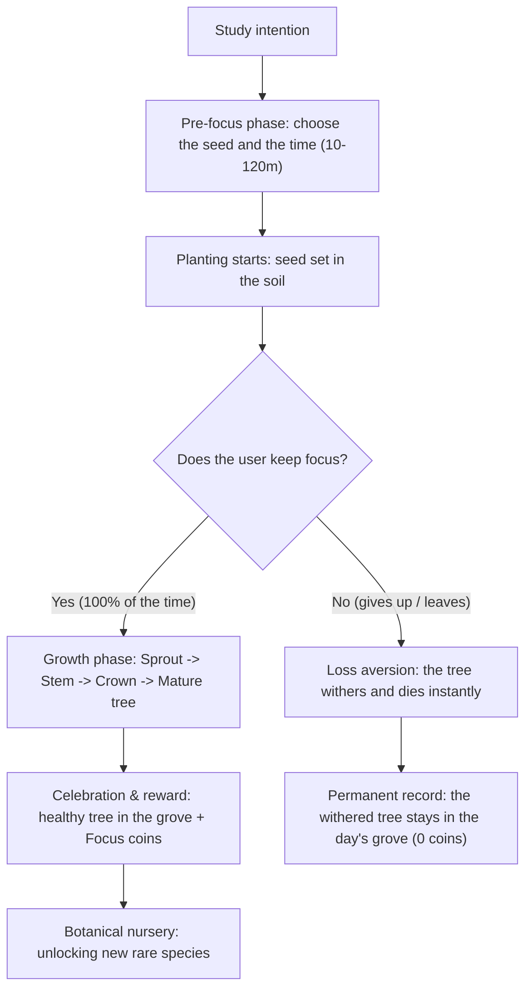
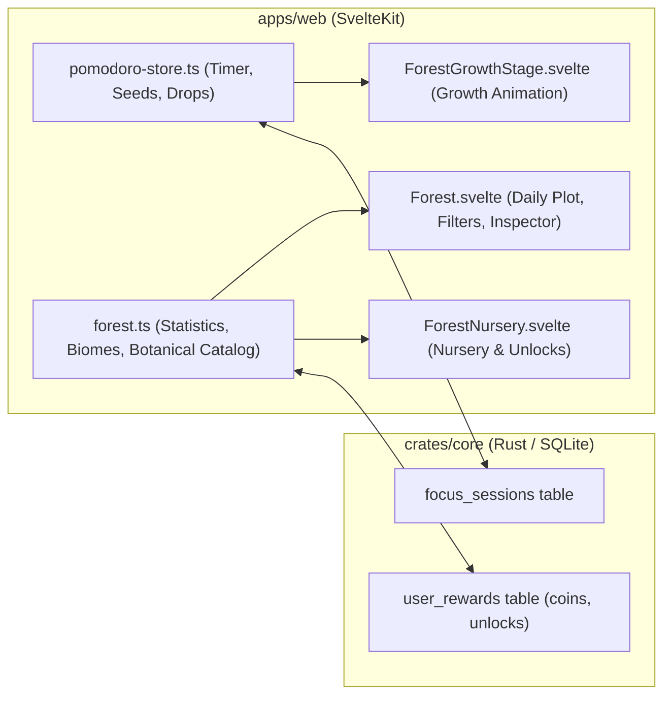

# Gamification research: the Forest app model for LearnVault

> **Superseded in part (2026-11-11).** The palette, themes, navigation and gamification described here were replaced by the direction in [`DESIGN.md`](../../DESIGN.md) and [`PRODUCT.md`](../../PRODUCT.md): light and dark themes, brown and amber, Playfair Display and DM Sans, top navigation, no forest. Where this file names a palette, a theme or a layout, those two files win. It is kept as history and for the research and the accessibility and security rules, which still apply.

This document consolidates the behavioral, interface and software-architecture research on the gamification model of the **Forest: Stay Focused** app (Seekrtech Co., Ltd.), structuring its transposition, in line with the structural-reference policy, into LearnVault's **Study Forest**.

---

## 1. Primary sources and references

| Source | Type | Citation / identifier | Relevance for LearnVault |
|---|---|---|---|
| **Seekrtech Co., Ltd.** | Official product documentation / App Store & Google Play | [forestapp.cc](https://www.forestapp.cc/) | Mechanics specification: planting, growth cycle (10–120 min), loss aversion (withered tree), virtual-coin economy and species nursery. |
| **Yu-kai Chou** | Gamification theory framework | *Actionable Gamification: Beyond Points, Badges, and Leaderboards* (2015), Octalysis Group | Mapping of the 8 Core Drives: balance between positive motivation (*White Hat*) and urgency/loss aversion (*Black Hat*). |
| **Cirillo, Francesco** | Productivity methodology | *The Pomodoro Technique* (2006) | Timeboxing cycles (25 min focus / 5 min short break / 15 min long break), reduced cognitive load and biological intervals. |
| **W3C WAI** | Normative accessibility | [WCAG 2.2](https://www.w3.org/TR/WCAG22/) | Colour contrast requirements (AA/AAA), keyboard navigation (`Enter`, `Space`, `Escape`), `prefers-reduced-motion` support for botanical animations and announcements through `aria-live`. |

---

## 2. Anatomy of Forest's gamification model

Forest's success lies in the harmonious fusion of **strict timeboxing** with a **tangible ecological metaphor**, where each minute of abstaining from distractions generates virtual life.

### 2.1 The four behavioral pillars

#### 1. Active loss aversion (*Loss Aversion* / Core Drive 8)
- In ordinary timers, interrupting a session has no tangible consequence beyond a counter reset to zero.
- In Forest, interrupting the session triggers an immediate emotional loss: **the plant is killed**.
- The give-up dialog confronts the user: *"Do you really want to give up? Your little tree will wither and die."*
- The dead tree **does not disappear**: it stays in that day's plot as a grey, dried-out stump, serving as a visual reminder of vulnerability to distraction.

#### 2. Real-time visual progression (*Live Growth Stages* / Core Drive 2)
The process is not an abstract numeric progress bar, but a continuous botanical transformation:
- **Stage 1 (0% to 25%):** Germinated seed with a sprout breaking the soil.
- **Stage 2 (25% to 50%):** Green stem lengthening with the first young leaves.
- **Stage 3 (50% to 75%):** Branching and a young crown.
- **Stage 4 (75% to 100%):** Full flowering of the mature crown (dense foliage, fruit, flowers or an aura).

#### 3. Closed circular economy (*Virtuous Currency Loop* / Core Drive 4)
- **Earning coins:** Completing a healthy session yields coins proportional to the time focused:
  $$\text{Coins} = \max\left(1, \lfloor \text{Minutes} \times 0.5 \rfloor\right) + \text{Streak bonus}$$
- **Withered / cancelled sessions:** 0 coins.
- **Nursery / unlock shop:** Coins do not buy power or shortcuts; they buy **aesthetic botanical diversity** (new species such as Cherry, Willow, Ginkgo, Birch, Ancient Tree).
- **No pay-to-win:** In LearnVault, the whole economy is local, free and the exclusive fruit of the student's effort.

#### 4. Concentration sentinel phrases (*Focus Guardians*)
During the countdown, short, expressive phrases alternate on the display to protect the student against procrastination impulses:
- *"Don't look over here, keep paying attention to the lesson!"*
- *"Your little sapling is putting down deep roots in the soil..."*
- *"Resist the temptation to switch windows!"*
- *"A little more focus and your tree will bloom radiantly."*

---

## 3. Evaluation in the Octalysis Framework (Yu-kai Chou)

| Core Drive | Application in Forest | Transposition to LearnVault |
|---|---|---|
| **CD1: Epic Meaning** | Partnership with NGOs to plant real trees in Africa. | Commitment to autonomous mastery of knowledge and professional training without dependence on proprietary platforms. |
| **CD2: Development and Accomplishment** | Saplings grow into trees; daily, weekly and yearly statistics. | A dynamic forest with ecosystems (Clearing → Grove → Reserve → Sanctuary), level badges and a herbarium. |
| **CD3: Empowerment of Creativity** | Choice of species and a personalized island layout. | The student chooses beforehand which seed to plant for each lesson or study block. |
| **CD4: Ownership and Possession** | Collectible catalog of trees unlocked with coins. | A system of "Focus Drops / Seeds" accumulated to unlock new species in the local Botanical Nursery. |
| **CD5: Social Influence** | "Plant Together" mode with friends. | In LearnVault (local-first / self-hosted), the focus is introspective and individual, with optional sharing of summary badges. |
| **CD6: Scarcity and Challenge** | Rare trees that require large amounts of coins or seasonal events. | Noble species (such as Golden Ginkgo and Ancient Tree) require consistent hours of study to unlock. |
| **CD7: Curiosity and Unpredictability** | Sporadic bonus drops and surprise motivational phrases. | Messages of wisdom and reflection on the content studied when completing cycles. |
| **CD8: Loss Aversion** | The tree dies if you leave the app. | Abandoning the session midway makes the tree wither, and it is recorded in the history as a monument for reflection. |

---

## 4. Original architecture proposed for LearnVault

To implement the Forest experience in LearnVault without breaching the structural-reference policy and while keeping the lightness of the Rust + Svelte ecosystem:

### 4.1 Specification of the new capabilities

1. **Botanical Nursery species catalog (`forest-catalog.ts`):**
   - **Sapling:** Unlocked by default (cost 0). Ideal for sessions of 10 to 20 min.
   - **Leafy Oak (Oak):** Unlocked by default (cost 0). Classic size for 25 to 35 min.
   - **Noble Pine (Pine):** Unlockable for 40 Focus Drops.
   - **Blossoming Cherry (Sakura):** Unlockable for 80 Focus Drops.
   - **Weeping Willow (Willow):** Unlockable for 120 Focus Drops.
   - **Golden Ginkgo Biloba (Ginkgo):** Unlockable for 200 Focus Drops.
   - **Ancient / Millennial Tree (Ancient):** Unlockable for 350 Focus Drops.

2. **Pre-focus seed selector (`FocusMenu.svelte` & `Forest.svelte`):**
   - Before starting the timer, the user can click the active seed's icon to switch among the unlocked species in their collection.
   - Contextual linking: if the user is watching a lesson of a course, the session inherits the course's ID and name automatically as a thematic label.

3. **Real-time botanical growth animation:**
   - During the Pomodoro countdown, a dynamic component shows the 4 stages of the chosen seed, recalculating from `(elapsedTime / totalTime)`.
   - If the session is aborted, a smooth defoliation transition turns the tree into the withered variant (`withered`).

4. **Botanical coins ("Focus Drops"):**
   - Persisted locally and syncable to the student's profile.
   - Shown in the forest header beside the ecosystem's crest.

5. **Synthesized soundscapes (Soundscapes via the Web Audio API):**
   - No dependence on heavy external MP3s: procedural audio synthesis for soft rain (*pink noise* with a low-pass filter) and a sea breeze (*brown noise* with amplitude modulation).

---

## 5. Accessibility and performance guidelines

- **Reduced motion (`prefers-reduced-motion: reduce`):** The growth transitions of leaves and branches must be static or in discrete jumps without continuous interpolation when the system preference is on.
- **Screen readers (`aria-live` and semantic descriptions):**
  - The start of a planting announces: *"Planting of [Species] started for a cycle of [X] minutes."*
  - Completion announces: *"Congratulations! Your [Species] tree bloomed successfully. You received [X] focus drops."*
  - Abandoning announces: *"Session interrupted. The [Species] tree withered."*
- **Code ceiling:** Components split into cohesive submodules of under 400 lines (strictly respecting the repository's 800-line ceiling).
