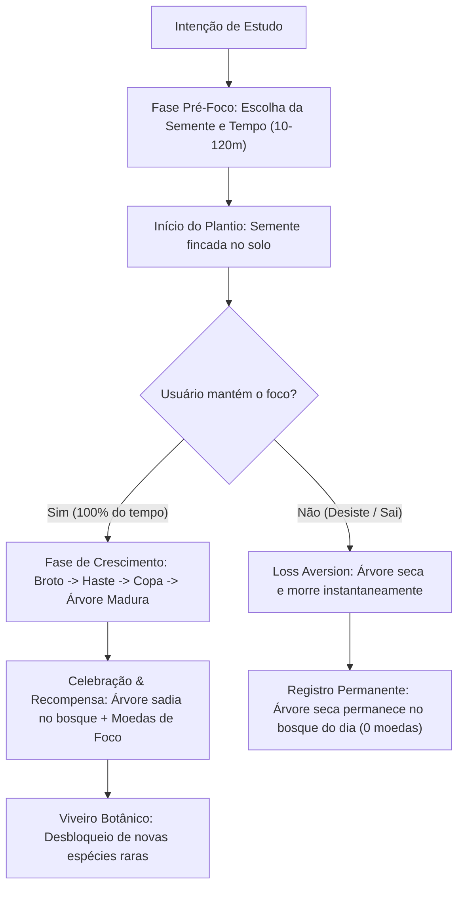
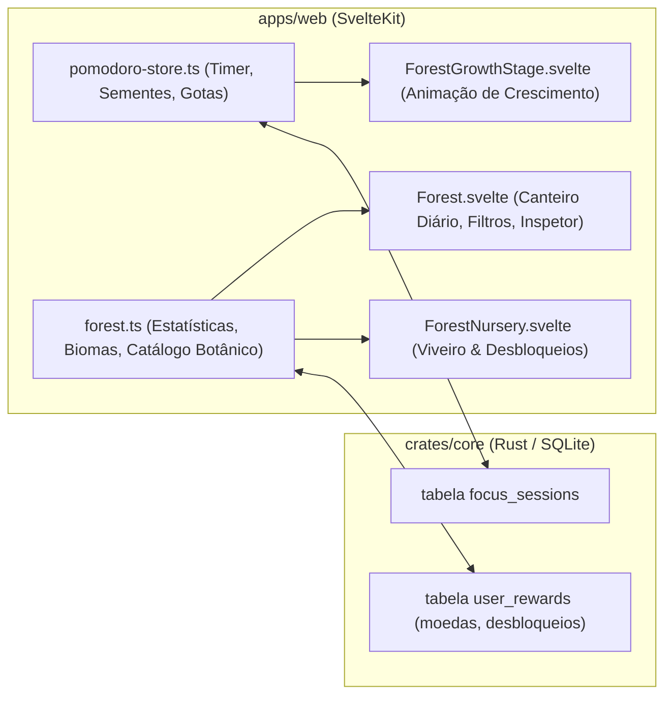

# Pesquisa de Gamificação: Modelo Forest App para o LearnVault

Este documento consolida a pesquisa comportamental, de interface e de arquitetura de software sobre o modelo de gamificação do aplicativo **Forest: Stay Focused** (Seekrtech Co., Ltd.), estruturando a sua transposição em conformidade com a política *clean-room* para a **Floresta de Estudos** do LearnVault.

---

## 1. Fontes Primárias e Referências

| Fonte | Tipo | Citação / Identificador | Relevância para o LearnVault |
|---|---|---|---|
| **Seekrtech Co., Ltd.** | Documentação oficial do produto / App Store & Google Play | [forestapp.cc](https://www.forestapp.cc/) | Especificação de mecânica: plantio, ciclo de crescimento (10–120 min), aversão à perda (árvore seca), economia de moedas virtuais e viveiro de espécies. |
| **Yu-kai Chou** | Framework teórico de gamificação | *Actionable Gamification: Beyond Points, Badges, and Leaderboards* (2015), Octalysis Group | Mapeamento dos 8 Motivadores Centrais (*Core Drives*): equilíbrio entre motivação positiva (*White Hat*) e senso de urgência/aversão à perda (*Black Hat*). |
| **Cirillo, Francesco** | Metodologia de produtividade | *The Pomodoro Technique* (2006) | Ciclos de timeboxing (25 min foco / 5 min pausa curta / 15 min pausa longa), redução da sobrecarga cognitiva e intervalos biológicos. |
| **W3C WAI** | Acessibilidade normativa | [WCAG 2.2](https://www.w3.org/TR/WCAG22/) | Requisitos de contraste de cores (AA/AAA), navegação por teclado (`Enter`, `Space`, `Escape`), suporte a `prefers-reduced-motion` para animações botânicas e anúncios via `aria-live`. |

---

## 2. Anatomia do Modelo de Gamificação do Forest

O sucesso do app Forest reside na fusão harmoniosa de **timeboxing rigoroso** com uma **metáfora ecológica tangível**, onde cada minuto de abstinência de distrações gera vida virtual.

### 2.1 Os Quatro Pilares Comportamentais

#### 1. Aversão à Perda Ativa (*Loss Aversion* / Core Drive 8)
- Em cronômetros comuns, interromper uma sessão não gera consequência palpável além de um contador zerado.
- No Forest, interromper a sessão aciona uma perda emocional imediata: **a planta é assassinada**.
- O diálogo de desistência confronta o usuário: *"Deseja realmente desistir? Sua árvorezinha secará e morrerá."*
- A árvore morta **não desaparece**: ela permanece no canteiro daquele dia como um toco cinzento e ressecado, servindo de lembrete visual de vulnerabilidade à distração.

#### 2. Progressão Visual em Tempo Real (*Live Growth Stages* / Core Drive 2)
O processo não é uma barra de progresso numérica abstrata, mas uma transformação botânica contínua:
- **Estágio 1 (0% a 25%):** Semente germinada com brotinho rompendo o solo.
- **Estágio 2 (25% a 50%):** Caule verde se alongando com primeiras folhas jovens.
- **Estágio 3 (50% a 75%):** Ramificação de galhos e copa jovem.
- **Estágio 4 (75% a 100%):** Florescimento pleno da copa madura (folhagem densa, frutos, flores ou aura).

#### 3. Economia Circular Fechada (*Virtuous Currency Loop* / Core Drive 4)
- **Ganho de Moedas:** Concluir uma sessão sadia rende moedas proporcionais ao tempo focado:
  $$\text{Moedas} = \max\left(1, \lfloor \text{Minutos} \times 0.5 \rfloor\right) + \text{Bônus de Sequência}$$
- **Sessões Secas / Canceladas:** 0 moedas.
- **Viveiro / Loja de Desbloqueio:** As moedas não compram poder ou atalhos; compram **diversidade botânica estética** (espécies novas como Cerejeira, Salgueiro, Ginkgo, Bétula, Árvore Ancestral).
- **Sem Pay-to-Win:** No LearnVault, toda a economia é local, gratuita e fruto exclusivo do esforço do estudante.

#### 4. Frases Sentinelas de Concentração (*Guardiões do Foco*)
Durante a contagem regressiva, frases curtas e expressivas alternam-se no visor para proteger o estudante contra impulsos de procrastinação:
- *"Não olhe para cá, continue prestando atenção na aula!"*
- *"Sua mudinha está criando raízes profundas no solo..."*
- *"Resista à tentação de trocar de janela!"*
- *"Mais um pouco de foco e sua árvore florescerá radiante."*

---

## 3. Avaliação no Octalysis Framework (Yu-kai Chou)

| Motivador (Core Drive) | Aplicação no Forest | Transposição para o LearnVault |
|---|---|---|
| **CD1: Significado Maior (*Epic Meaning*)** | Parceria com ONGs para plantio de árvores reais na África. | Compromisso com o domínio autônomo do conhecimento e formação profissional sem dependência de plataformas proprietárias. |
| **CD2: Desenvolvimento e Conquista** | Mudas crescem para árvores; estatísticas diárias, semanais e anuais. | Floresta dinâmica com ecossistemas (Clareira → Bosque → Reserva → Santuário), insígnias de nível e herbanário. |
| **CD3: Empoderamento da Criatividade** | Escolha de espécies e layout personalizado da ilha. | O estudante escolhe previamente qual semente plantar em cada aula ou bloco de estudo. |
| **CD4: Propriedade e Posse** | Catálogo colecionável de árvores desbloqueadas com moedas. | Sistema de "Gotas de Foco / Sementes" acumuladas para desbloquear novas espécies no Viveiro Botânico local. |
| **CD5: Influência Social** | Modo "Plantar Juntos" com amigos. | No LearnVault (local-first / auto-hospedado), o foco é introspectivo e individual, com compartilhamento opcional de badges de síntese. |
| **CD6: Escassez e Desafio** | Árvores raras que exigem altas quantias de moedas ou eventos sazonais. | Espécies nobres (como Ginkgo Dourado e Árvore Ancestral) exigem horas consistentes de estudo para desbloqueio. |
| **CD7: Curiosidade e Imprevisibilidade** | Gotas de bônus esporádicas e frases motivacionais surpresa. | Mensagens de sabedoria e reflexão sobre o conteúdo estudado ao concluir ciclos. |
| **CD8: Aversão à Perda (*Loss Aversion*)** | Árvore morre se sair do aplicativo. | Ao abandonar a sessão no meio, a árvore seca e é gravada no histórico como monumento de reflexão. |

---

## 4. Arquitetura Clean-Room Proposta para o LearnVault

Para implementar a experiência do Forest no LearnVault sem ferir a política *clean-room* e mantendo a leveza do ecossistema Rust + Svelte:

### 4.1 Especificação das Novas Capacidades

1. **Catálogo de Espécies do Viveiro Botânico (`forest-catalog.ts`):**
   - **Brotinho (Sapling):** Desbloqueado por padrão (custo 0). Ideal para sessões de 10 a 20 min.
   - **Carvalho Frondoso (Oak):** Desbloqueado por padrão (custo 0). Porte clássico para 25 a 35 min.
   - **Pinheiro Nobre (Pine):** Desbloqueável por 40 Gotas de Foco.
   - **Cerejeira em Flor (Sakura):** Desbloqueável por 80 Gotas de Foco.
   - **Salgueiro Chorão (Willow):** Desbloqueável por 120 Gotas de Foco.
   - **Ginkgo Biloba Dourado (Ginkgo):** Desbloqueável por 200 Gotas de Foco.
   - **Árvore Ancestral / Milenar (Ancient):** Desbloqueável por 350 Gotas de Foco.

2. **Seletor de Semente Pré-Foco (`FocusMenu.svelte` & `Forest.svelte`):**
   - Antes de iniciar o timer, o usuário pode clicar no ícone da semente ativa para alternar entre as espécies desbloqueadas do seu acervo.
   - Vinculação contextual: se o usuário estiver assistindo a uma aula de um curso, a sessão herda o ID e nome do curso automaticamente como etiqueta temática.

3. **Animação Botânica de Crescimento em Tempo Real:**
   - Durante a contagem decrescente do Pomodoro, um componente dinâmico exibe os 4 estágios da semente escolhida, recalculando com base em `(tempoDecorrido / tempoTotal)`.
   - Se a sessão for abortada, uma transição de desfolhamento suave transforma a árvore na variante seca (`withered`).

4. **Moedas Botânicas ("Gotas de Foco"):**
   - Persistidas localmente e sincronizáveis no perfil do estudante.
   - Exibidas no cabeçalho da floresta ao lado do brasão do ecossistema.

5. **Paisagens Sonoras Sintetizadas (Soundscapes via Web Audio API):**
   - Sem dependência de MP3s externos pesados: síntese procedural de áudio para chuva suave (*pink noise* com filtro passa-baixa) e brisa marinha (*brown noise* modulado em amplitude).

---

## 5. Diretrizes de Acessibilidade e Desempenho

- **Redução de Movimento (`prefers-reduced-motion: reduce`):** As transições de crescimento de folhas e ramos devem ser estáticas ou em saltos discretos sem interpolação contínua quando a preferência do sistema estiver ativada.
- **Leitores de Tela (`aria-live` e descrições semânticas):**
  - O início de um plantio anuncia: *"Plantio de [Espécie] iniciado para ciclo de [X] minutos."*
  - A conclusão anuncia: *"Parabéns! Sua árvore de [Espécie] floresceu com sucesso. Você recebeu [X] gotas de foco."*
  - O abandono anuncia: *"Sessão interrompida. A árvore de [Espécie] secou."*
- **Teto de Código:** Componentes divididos em submódulos coesos com menos de 400 linhas (respeitando rigorosamente o teto de 800 linhas do repositório).
